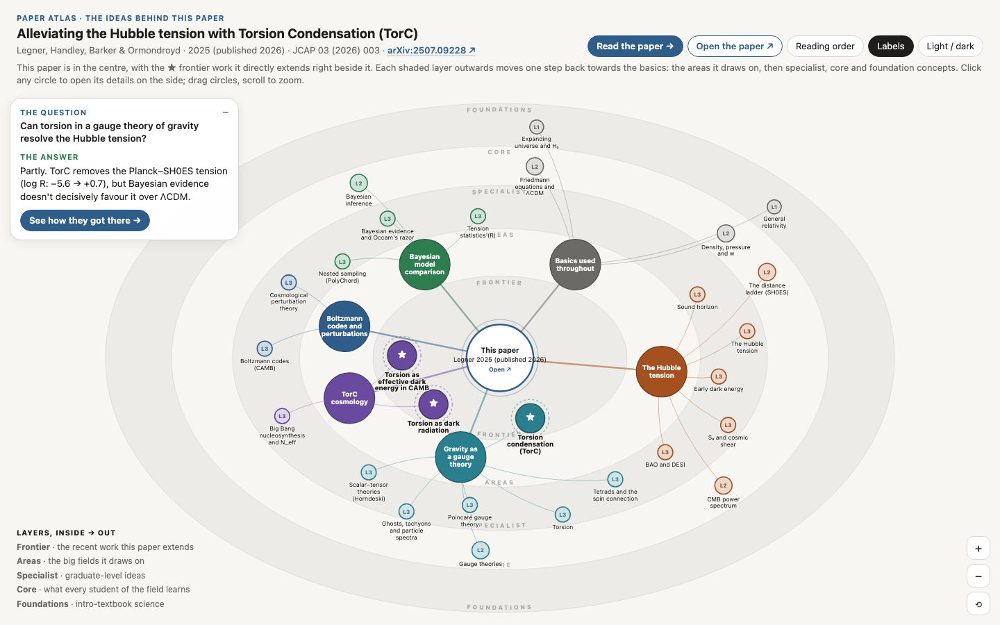
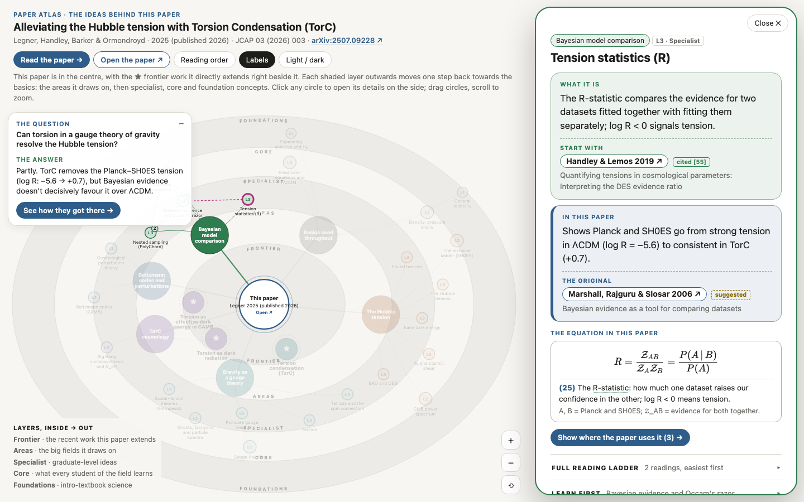
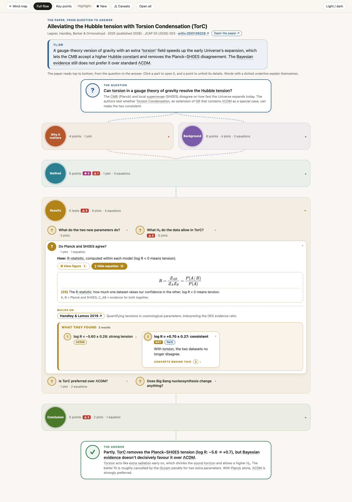

# paper-map

Turns a research paper into an interactive **paper atlas**: a single HTML page that shows what the paper asks
and finds, how it gets there, and what a newcomer needs to learn first, with a reading list for every concept.

The example used throughout is the TorC paper, *Alleviating the Hubble tension with Torsion Condensation*
(Legner, Handley, Barker & Ormondroyd, [arXiv:2507.09228](https://arxiv.org/abs/2507.09228)):
open [`maps/arxiv-2507.09228.atlas.html`](maps/arxiv-2507.09228.atlas.html) in a browser.

## What the atlas shows

### 1. The mind map: the ideas behind the paper



The paper sits in the centre, with its question and answer in a card beside it. Around it are the big **areas**
it draws on (for TorC: the Hubble tension, gravity as a gauge theory, TorC cosmology, Boltzmann codes,
Bayesian model comparison, and the basics), and further out their **concepts**, in shaded layers: the further
out, the more basic.

| Layer | Meaning | TorC examples |
|---|---|---|
| Frontier ★ | the recent work this paper directly extends | torsion condensation, torsion as dark radiation, torsion as effective dark energy in CAMB |
| Areas | the fields it draws on | the Hubble tension, gravity as a gauge theory |
| Specialist | graduate-level ideas | Poincaré gauge theory, nested sampling, the R-statistic |
| Core | what every student of the field learns | the CMB power spectrum, Friedmann equations, gauge theories |
| Foundations | intro-textbook science | the expanding universe and H₀, general relativity |

Circles float and can be dragged; scroll to zoom.

### 2. Concept cards: what it is, why it's here, where to read



Clicking a concept opens a card on the side (the map narrows so it stays visible). Each card has:
- **What it is**, in plain words, with the most basic reading to start with.
- **In this paper**, with the paper(s) this work builds on.
- **The equation in this paper**, typeset, when one belongs to the concept (above: the R-statistic, Eq. 25).
- Folded sections: the full reading ladder (*Start here → Go deeper → The original → What this paper builds on*),
  what to learn first, and the path from the basics, which is also numbered on the map.

Readings come from the paper's own reference list where possible (tagged `cited [N]`). Basic textbooks and
reviews it doesn't cite are tagged `suggested`, e.g. Ryden's *Introduction to Cosmology* for the expanding
universe or Sivia & Skilling for Bayesian inference. *Reading order* lists every concept from the basics up.

### 3. The paper view: from question to answer



*Read the paper* lays the paper out top to bottom: **The question → [Why it matters | Background] → Method →
Results → Conclusion → The answer**. Parts open on click; each point unfolds in place with its detail, the papers
it builds on, and the concepts behind it.

- **Results** has one entry per test (*Do Planck and SH0ES agree?*, *Is TorC preferred over ΛCDM?*, ...), each with
  how it was done and a highlighted *What they found* panel, one finding per dataset or model
  (`ΛCDM` vs `TorC`, `Planck only` vs `Planck + SH0ES`).
- **★ NEW** marks what the paper adds (for TorC: recasting torsion as an effective dark-energy ρ(a), P(a) in CAMB,
  and the first full Planck + SH0ES fit). **⚠ CAVEAT** marks what a referee would worry about (background only,
  no TorC perturbations yet; ghost-freedom shown only around zero torsion). *Highlight* fades everything else.
- **View figures / View equations** buttons in each part, test or point reveal the paper's plots (click one to
  open it full-screen) and key equations, with a plain explanation of each.
- Words with a **dotted underline** (*R-statistic*, *SH0ES*, *torsion*, ...) open a short explainer with where
  to start reading.
- *Key points* gives the short version: question → the key points → answer.
- The arXiv ID and *Open the paper* link go to the paper itself.

## Making an atlas

With an Anthropic API key, from a PDF or an arXiv ID:

```sh
export ANTHROPIC_API_KEY=sk-ant-...
python3 atlas.py 2507.09228 --open
```

This makes two Claude calls (the paper map and the learning map), crops the figures from the PDF, and writes
`arxiv-2507.09228.json`, `arxiv-2507.09228.roots.json`, and the self-contained `arxiv-2507.09228.atlas.html`.
`--effort low|medium|high|xhigh|max` trades speed and cost against depth (default `high`).

To rebuild from saved maps, e.g. after editing them by hand (`--pdf` re-crops the figures):

```sh
python3 atlas.py --map maps/arxiv-2507.09228.json --roots maps/arxiv-2507.09228.roots.json --pdf 2507.09228
```

**Without an API key**, ask Claude Code: *"Read this paper and write `<name>.json` following `SCHEMA` in
`paper_map.py` and `<name>.roots.json` following `SCHEMA` in `roots_map.py`, then run `atlas.py` on them."*
That is how the maps in `maps/` were made.

Figure cropping needs PyMuPDF (`pip install pymupdf`); equations are typeset with KaTeX, loaded from a CDN the
first time they are opened (offline they show as LaTeX source). Everything else works offline.

## The two maps behind an atlas

**The paper map** (`<name>.json`, schema in `paper_map.py`) is the paper as written: `question` and `answer`
(plus `other_questions` if it answers more than one big question), `why_important`, `background`, `setup`,
`analyses` (each a test with its results and their conditions), `conclusion`, `figures`, `equations` and
`references`. Each point has a `flag`: `novel`, `caveat`, `key` or `none`.

Figures and equations say where they belong with `attach`, which may list several places:

| `attach` | Shown in |
|---|---|
| `background`, `setup`, `conclusion`, ... | that part |
| `results:3` | the 3rd test |
| `setup#2` | the 2nd point of Method |
| `results:3#1` | the 1st finding of the 3rd test |

For TorC, Eq. 25 (the R-statistic) has `"attach": "results:3"` and `"concepts": ["rstat"]`, so it appears in
the *Do Planck and SH0ES agree?* test and on the R-statistic concept card.

**The learning map** (`<name>.roots.json`, schema in `roots_map.py`) is what a newcomer needs: `sections` (the
areas, each with what it is, its part in the paper and the best way in), `concepts` (each with a level from 1
foundations to 4 frontier, a plain explanation, why the paper needs it, `prereqs`, the words the paper uses for
it, and a reading ladder) and `readings`.

## Other outputs

- `paper_map.py paper.pdf` makes the paper map alone as a standalone page (`template.html`).
- `roots_map.py paper.pdf` makes the learning map alone, with *Ladder*, *By paper section* and *Bookshelf* views
  (`roots_template.html`).

## Examples

| Paper | Atlas |
|---|---|
| Legner et al., *Alleviating the Hubble tension with Torsion Condensation (TorC)*, arXiv:2507.09228 | [`maps/arxiv-2507.09228.atlas.html`](maps/arxiv-2507.09228.atlas.html) |
| Vaswani et al., *Attention Is All You Need*, arXiv:1706.03762 | [`maps/arxiv-1706.03762.atlas.html`](maps/arxiv-1706.03762.atlas.html) |

## Files

- `atlas.py`, `atlas_template.html`: the atlas (mind map, concept cards, paper view)
- `paper_map.py`, `template.html`: the paper map, PDF/arXiv loading and the Claude call (`claude-opus-5-5`, structured output)
- `roots_map.py`, `roots_template.html`: the learning map
- `figures.py`: crops numbered figures out of a PDF
- `maps/`: the example maps and atlases; `examples/`: a hand-written paper map (Riess et al. 1998)
- `docs/`: the screenshots above
